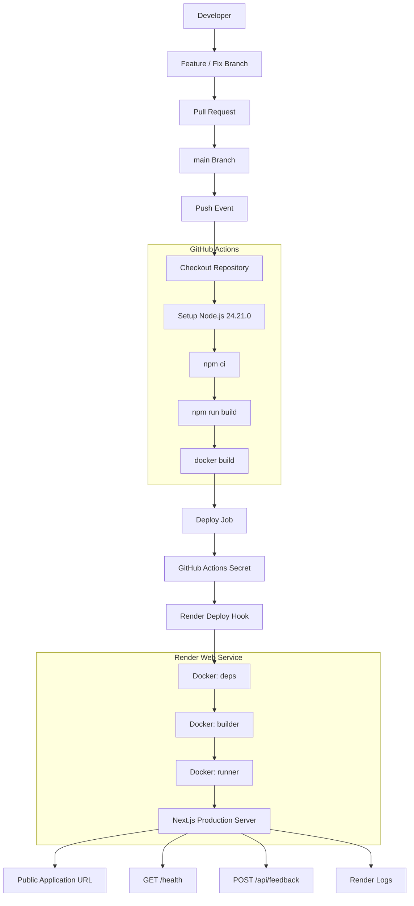
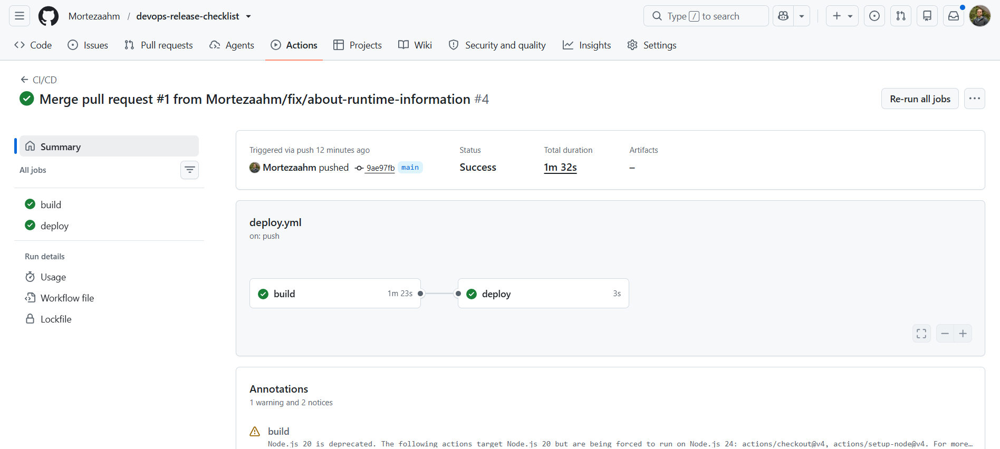
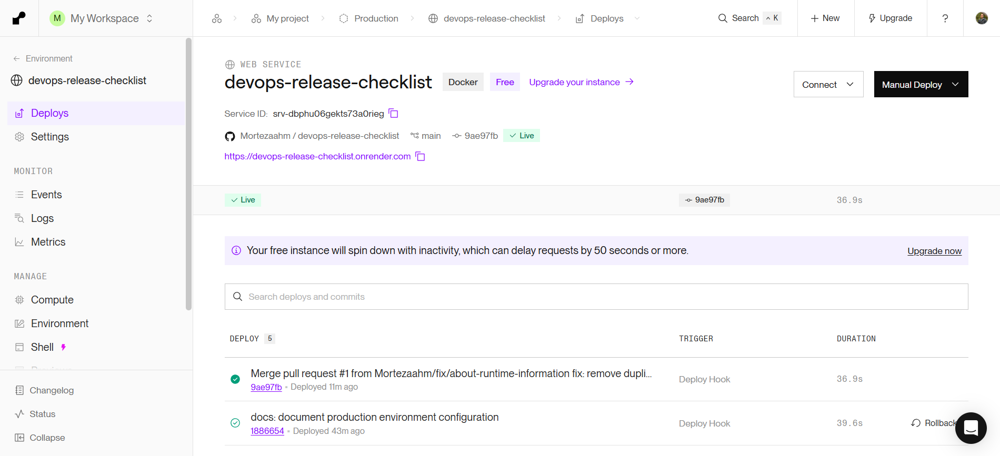
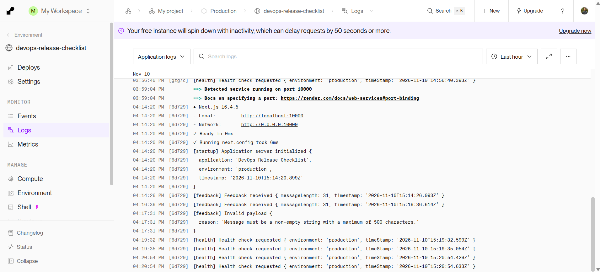

# DevOps Release Checklist
A lightweight web application built with Next.js, TypeScript and Tailwind CSS to demonstrate modern DevOps practices, Docker containerization, CI/CD automation and cloud deployment.
The project focuses on the complete software delivery lifecycle, from local development and environment configuration to automated builds and production deployment on Render.

**Live Application:** [Open DevOps Release Checklist](https://devops-release-checklist.onrender.com)

**GitHub Repository:** [View Source Code](https://github.com/Mortezaahm/devops-release-checklist)

---

## Table of Contents

1. Project Overview
2. Features
3. Technology Stack
4. System Architecture
5. Local Development
6. Environment Configuration
7. Docker Containerization
8. Logging and Monitoring
9. CI/CD Pipeline
10. Render Deployment
11. Security Considerations
12. Cost-aware Operations
13. Limitations and Future Improvements
14. Deployment Evidence

---

## 1. Project Overview

DevOps Release Checklist is a lightweight application developed to demonstrate the practical implementation of a modern software delivery workflow.
The project combines frontend development with essential DevOps practices, including:
- Application development using Next.js and React.
- Environment-specific configuration.
- Docker-based containerization.
- Multi-stage Docker builds.
- Automated build validation using GitHub Actions.
- Automated deployment using Render Deploy Hooks.
- Application logging and health monitoring.
- Cost-aware cloud deployment.

The main objective is to demonstrate how an application can move from local development to a production environment through a structured and automated CI/CD pipeline. The application is intentionally kept simple because the primary focus is on deployment architecture and automation rather than application complexity.

## 2. Features

- Interactive release checklist.
- Dashboard interface for tracking release readiness.
- About page displaying application and runtime information.
- Runtime environment configuration.
- Server health endpoint.
- Feedback API endpoint with request validation.
- Server startup logging.
- INFO and ERROR logging.
- Docker-based production execution.
- Automated CI/CD deployment workflow.

Checklist data is stored in browser localStorage. This provides local persistence within the same browser but does not synchronize data between different users or devices.

## 3. Technology Stack

| Technology | Purpose |
|---|---|
| Next.js 16 | React framework and application routing |
| React | UI development |
| TypeScript | Static typing and maintainability |
| Tailwind CSS | Styling and responsive UI |
| Node.js 24.21.0 | Server runtime |
| npm | Dependency management |
| Docker | Application containerization |
| GitHub | Source code management |
| GitHub Actions | CI/CD automation |
| Render | Cloud hosting and deployment |

### Why Next.js?
Next.js was selected because it provides both frontend and server-side capabilities within one framework.
It supports File-based routing and have server Components. It also supports route handlers for API endpoints and good for production optimization. It has standalone output for Docker deployment as well.
This makes it suitable for demonstrating both application development and server-side deployment concepts.

## 4. System Architecture

The application follows a containerized deployment architecture.

### Architecture Diagram



### Deployment Flow
1. Development takes place locally.
2. Changes are committed to a feature or fix branch.
3. A Pull Request is created against `main`.
4. The changes are reviewed and merged into `main`.
5. GitHub Actions starts automatically after the push to `main`.
6. The application dependencies are installed.
7. The production application build is validated.
8. A Docker image is built to validate the Dockerfile.
9. If all build steps succeed, GitHub Actions calls the Render Deploy Hook.
10. Render retrieves the latest source code and builds the production Docker image.
11. Render starts the new application container.
12. Render performs health checks before routing traffic to the new instance.

This separation ensures that deployment is triggered only after the application and Docker build steps have completed successfully.

## 5. Local Development

### Prerequisites
Tools required:
- Node.js 24.21.0
- npm
- Git
- Docker Desktop (for container testing)

### Clone the repository
```bash
git clone https://github.com/Mortezaahm/devops-release-checklist
cd devops-release-checklist
```

### Install dependencies
```bash
npm ci
```
`npm ci` installs dependencies based on the package-lock.json file and provides a reproducible installation.

### Configure environment variables
Create a `.env.local` file in the project root:
```env
APP_ENV=development
APP_NAME="DevOps Release Checklist (Local)"
```

### Start the development server
```bash
npm run dev
```
Open:
http://localhost:3000

### Available pages and endpoints
| Route | Description |
|---|---|
| `/` | Main checklist dashboard |
| `/about` | Application and runtime information |
| `/health` | Server health endpoint |
| `/api/feedback` | Feedback API endpoint |

### Production build verification
To verify that the application can be built locally:
```bash
npm run lint
npm run build
```

## 6. Environment Configuration
The application uses environment variables to separate configuration from application source code.

### Environment variables
| Variable | Development | Production | Purpose |
|---|---|---|---|
| `APP_ENV` | `development` | `production` | Identifies the runtime environment |
| `APP_NAME` | Local application name | DevOps Release Checklist | Defines the application name |

### Local configuration
Local development variables are stored in `.env.local`.

### Production configuration
Production environment variables are configured through the Render Dashboard.

| Variable | Production value | Purpose |
|---|---|---|
| `APP_ENV` | `production` | Identifies the production environment |
| `APP_NAME` | `DevOps Release Checklist` | Defines the application name |

These variables are injected into the Docker container at runtime. They are not hardcoded in the application source code. This allows the same Docker image to run with different environment configurations without rebuilding the application specifically for each environment.

### Example environment file
The `.env.example` file provides example values for local configuration:
```env
APP_ENV=development
APP_NAME="DevOps Release Checklist"
```
Actual local environment files containing configuration or secrets are excluded from Git using `.gitignore`.

## 7. Docker Containerization
The application is containerized using Docker. The Dockerfile uses a multi-stage build strategy to produce a smaller and more efficient production image.

### Multi-stage build architecture
The Dockerfile contains three stages:

#### 1. deps
This stage installs the application dependencies.
Responsibilities:
- Uses Node.js 24.21.0 as the base image.
- Copies package.json and package-lock.json.
- Installs dependencies using `npm ci`.
Separating dependency installation makes the build process more predictable and allows Docker to reuse cached layers when possible.

#### 2. builder
This stage builds the Next.js application.
Responsibilities:
- Copies installed dependencies from the deps stage.
- Copies the application source code.
- Runs the production build.
- Generates the Next.js standalone output.
Next.js standalone output reduces the runtime files required by the production container.

#### 3. runner
This is the final production stage.
Responsibilities:
- Uses a Node.js base image.
- Copies the standalone application output.
- Copies the `public` directory.
- Copies `.next/static`.
- Runs the application using the generated `server.js`.
- Uses the non-root `node` user.
- Exposes port 3000.
- Configures the server to listen on `0.0.0.0`.
The container uses:
```dockerfile
ENV PORT=3000
ENV HOSTNAME="0.0.0.0"
USER node
CMD ["node", "server.js"]
```
The non-root execution model reduces the security impact of a potential application compromise.

### Why use multi-stage builds?
Multi-stage builds separate build-time dependencies from runtime requirements. This provides several benefits such as smaller production images, reduced unnecessary dependencies, better separation of build and runtime environments. This has also improved security through a smaller runtime attack surface and more efficient image distribution and deployment.

### Docker commands
Build the image:
```bash
docker build -t devops-release-checklist:local .
```
Run the container:
```bash
docker run --rm -p 3000:3000 \
  -e APP_ENV=production \
  -e "APP_NAME=DevOps Release Checklist" \
  devops-release-checklist:local
```
Check running containers:
```bash
docker ps
```
View container logs:
```bash
docker logs CONTAINER_ID
```
Test the health endpoint:
```bash
curl.exe -i http://localhost:3000/health
```
The application should return HTTP 200 with a JSON response indicating that the server is healthy.

### Docker image publishing
Docker Hub publishing is intentionally not included in this assignment. GitHub Actions validates the Docker image using `docker build`, while Render builds the production image directly from the repository's Dockerfile.

## 8. Logging and Monitoring
Logging is implemented to make application behavior easier to understand and troubleshoot.

### Startup logging
The application uses Next.js instrumentation to log a message when the server starts. The startup log includes relevant runtime information, such as application name, which environment it is in, startup timestamp and Node.js runtime version where available.
Example:
```text
[startup] Application server initialized
```

### INFO logging
Normal application events are logged using:
```javascript
console.info()
```
For example, successfully received feedback requests are logged as informational events.

### ERROR logging
Unexpected or invalid situations are logged using:
```javascript
console.error()
```
For example:
- Invalid JSON request bodies.
- Invalid feedback payloads.
- Request validation failures.
Logging errors makes it easier to identify incorrect requests and investigate application issues.

### Health endpoint
The application provides:
```http
GET /health
```
A successful response returns HTTP 200 and JSON containing:
- `status`
- `service`
- `environment`
- `timestamp`
- `uptimeSeconds`
The endpoint also uses the `Cache-Control: no-store` response header to prevent health responses from being cached.

Example response:
```json
{
  "status": "ok",
  "service": "devops-release-checklist",
  "environment": "production",
  "timestamp": "2026-11-11T08:00:00.000Z",
  "uptimeSeconds": 120
}
```
The timestamp and uptime values are examples; actual values are generated at runtime.

### Render health checks
Render is configured to use:
```text
/health
```
as its HTTP health check path.
Render periodically requests this endpoint to verify that the application instance is responsive. A successful HTTP response helps Render determine whether the instance is ready to receive traffic.

### Troubleshooting
Logging and health checks provide complementary information:
- Health checks indicate whether the application is responding.
- INFO logs show normal application activity.
- ERROR logs help identify invalid requests and failures.
- Startup logs help identify application initialization issues.
Application logs can be inspected through the Render Dashboard.

## 9. CI/CD Pipeline with GitHub Actions
The project uses GitHub Actions to automate application build validation and production deployment.
The workflow file is located at:
```text
.github/workflows/deploy.yml
```

### Workflow trigger
The pipeline runs automatically when code is pushed to:
```text
main
```
The workflow is intentionally configured for pushes to `main` only.
Pull Requests are reviewed and merged before the production deployment pipeline is triggered.

### Pipeline stages

#### Build job
The build job performs the following operations:
1. Checks out the repository using GitHub Actions.
2. Sets up Node.js 24.21.0.
3. Installs dependencies using `npm ci`.
4. Builds the application using `npm run build`.
5. Builds the Docker image using `docker build`.
The Docker image is built for validation only and is not pushed to Docker Hub.

#### Deploy job
The deployment job runs only after the build job succeeds. It reads the Render Deploy Hook URL from a GitHub Actions Secret and sends an HTTP request to trigger a deployment.
The deployment secret is:
```text
RENDER_DEPLOY_HOOK_URL
```
The actual Deploy Hook URL is never stored directly in the workflow file or application source code.

### Failure handling
The pipeline stops if any required build step fails. Since the deployment job depends on successful completion of the build job, Render is not triggered when application or Docker image validation fails. This prevents unsuccessful builds from being deployed.

### Why separate Build and Deploy jobs?
Because separating the jobs provides clear responsibility for each stage, a better failure visibility, a controlled deployment execution, a secure access to deployment credentials, and easier troubleshooting.
The assignment focuses on validating the application build, validating the Docker image build and triggering Render only after successful validation.

## 10. Render Deployment

The application is deployed as a Docker-based Web Service on Render.

### Deployment configuration

| Setting | Value |
|---|---|
| Service type | Web Service |
| Runtime | Docker |
| Source | GitHub repository |
| Production branch | `main` |
| Dockerfile | Dockerfile |
| Auto-Deploy | Off |
| Health Check Path | `/health` |
| Compute Plan | Free |

### Why Auto-Deploy is disabled
Auto-Deploy is disabled because deployment is controlled by GitHub Actions. This prevents Render from independently deploying every repository update.
Instead, GitHub Actions triggers the Render Deploy Hook only after the application and Docker build steps have succeeded. This gives the CI/CD pipeline control over when a new production deployment is initiated.

### Render deployment process
1. A successful GitHub Actions build completes.
2. The deployment job retrieves `RENDER_DEPLOY_HOOK_URL` from GitHub Secrets.
3. GitHub Actions calls the Deploy Hook.
4. Render retrieves the latest source code from the connected repository.
5. Render builds the Docker image using the Dockerfile.
6. Render starts the production container.
7. Render checks the `/health` endpoint.
8. The new deployment becomes live after successful deployment checks.
The application listens on the configured port and network interface:
```text
PORT=3000
HOSTNAME=0.0.0.0
```
This allows the application to receive incoming traffic through the Render service.

## 11. Security Considerations
Security has been considered throughout the application and deployment workflow.

### Environment variables
Application configuration is managed through environment variables rather than hardcoded values.

### GitHub Actions Secrets
The Render Deploy Hook URL is stored as a GitHub Actions Secret:
```text
RENDER_DEPLOY_HOOK_URL
```
The secret is accessed only by the deployment workflow. It is not committed to the repository.

### Git ignore
The `.gitignore` file prevents local environment files and other unnecessary or sensitive files from being committed.

### Docker security
The production container runs as the non-root `node` user instead of the root user. The multi-stage build also keeps unnecessary build-time dependencies out of the final runtime image.

### Browser environment variables
Environment variables exposed to the browser are not considered secrets. Sensitive values must remain server-side and must never be exposed through client-side code.

## 12. Cost-aware Operations

### 1. Which Render plan are you using?
The application uses Render's Free web service compute plan.
The Free plan provides:
- 0.1 CPU.
- 512 MB RAM.
- 750 free instance hours per workspace per calendar month.
The monthly free instance hours are shared across eligible services within the workspace.

### 2. Why did you choose this plan?
I chose the Free plan because this project is an educational application with a relatively small workload. The main purpose is to demonstrate Docker containerization, CI/CD automation, environment configuration and cloud deployment. The application does not require a database or significant computing resources. Therefore, a paid compute plan is not necessary for this demonstration.

### 3. Which factors affect the operating cost?
The main cost factors include:
- CPU and RAM allocation.
- Number of running service instances.
- Service running time.
- Outbound bandwidth.
- Build pipeline usage.
- Additional storage and managed database services.
Paid compute plans are billed according to the selected resources and actual usage. Exceeding included workspace allowances for outbound bandwidth or build pipeline usage may also result in additional charges, depending on the workspace billing configuration.

### 4. How can resource usage be reduced?
Resource usage can be reduced through several optimization techniques. For example, using a multi-stage Docker build and selecting a lightweight Node.js base image. It could also reduced by excluding unnecessary files with `.dockerignore`, installing dependencies with `npm ci`, keeping build-time dependencies out of the production image, avoiding unnecessary server-side processing. Also using browser storage for data that does not require server persistence and monitoring application logs and resource usage help this goal to be achieved. These techniques help reduce unnecessary resource consumption and improve deployment efficiency.

### 5. What limitations does the current deployment have?
The Free web service has several limitations. It spins down after 15 minutes without incoming traffic. The first request after inactivity can take approximately one minute to respond. It has limited CPU and RAM resources and supports only one running instance. It does not support persistent disks as well as horizontal scaling on the Free compute plan. The application also stores checklist data in browser localStorage. Therefore, data is not shared between different users or devices and is not stored in a centralized database. 
These limitations are acceptable for an educational demonstration but would need to be addressed for a real multi-user production application.

### 6. What would you change if the application received significantly more users?
I would consider the following improvements:

**Infrastructure**
- Upgrade to a paid compute plan with more CPU and RAM.
- Introduce horizontal scaling when needed.
- Improve availability through multiple running instances.

**Data architecture**
- Introduce PostgreSQL for shared and persistent data.
- Implement user authentication and authorization.
- Add database connection pooling.
- Optimize database queries and indexes.

**Performance**
- Introduce caching where appropriate.
- Use CDN-based delivery for static assets.
- Reduce unnecessary server-side processing.
- Monitor application response times and resource usage.

**Reliability and security**
- Improve centralized monitoring.
- Add automated tests to the development pipeline.
- Introduce more comprehensive error handling.
- Implement database backups and recovery procedures.
These changes would improve scalability, performance, availability, security and data reliability.

## 13. Limitations and Future Improvements
Although the project successfully demonstrates the required deployment workflow, several improvements could be introduced in a future version.

| Current limitation | Possible improvement |
|---|---|
| Checklist data stored in localStorage | Centralized PostgreSQL database |
| No user authentication | Authentication and authorization |
| Single Free instance | Multiple production instances |
| Limited application monitoring | Centralized monitoring and alerting |
| No automated test execution | Unit and integration tests |
| Basic API validation | More comprehensive API validation and error handling |

These improvements are outside the current assignment scope but provide a clear direction for future development.

## 14. Deployment Evidence
The following screenshots demonstrate the successful execution of the CI/CD pipeline and production deployment.

### GitHub Actions
The screenshot demonstrates that the application build, Docker image build and Render deployment trigger completed successfully.



### Render Deployment
The screenshot demonstrates a successful production deployment on Render.



### Render Application Logs
The screenshot demonstrates application logging in the Render Dashboard, including at least one informational message and one error message generated by the application.



---

## Conclusion

This project demonstrates a complete application delivery workflow using modern web development and DevOps technologies. By combining Next.js, Docker, GitHub Actions and Render, the application can be built, containerized, validated and deployed through an automated process. 
The project also demonstrates practical knowledge of multi-stage Docker builds, environment-specific configuration, and secure secret management. It also shows CI/CD automation, production deployment, application logging and health checks. 
Finally, this project illustrates cloud resource optimization and cost-aware operations.
The implementation provides a foundation for understanding how modern development teams automate the delivery of web applications from source code to production.

**Project:** DevOps Release Checklist  
**Framework:** Next.js  
**Containerization:** Docker  
**CI/CD:** GitHub Actions  
**Cloud Platform:** Render
**Author:** Morteza Ahmadianmanzary
